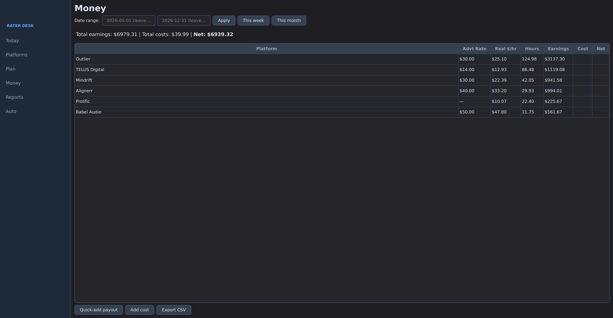
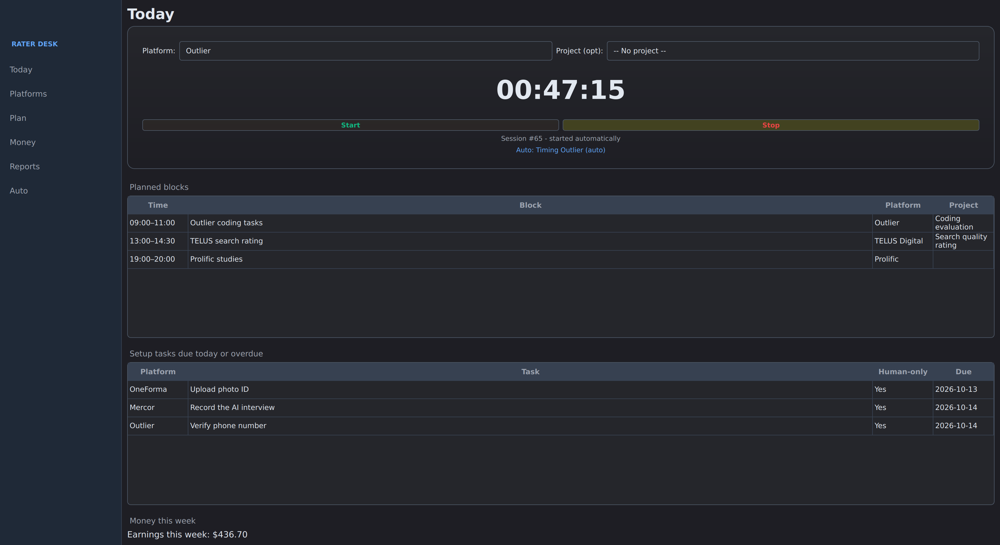
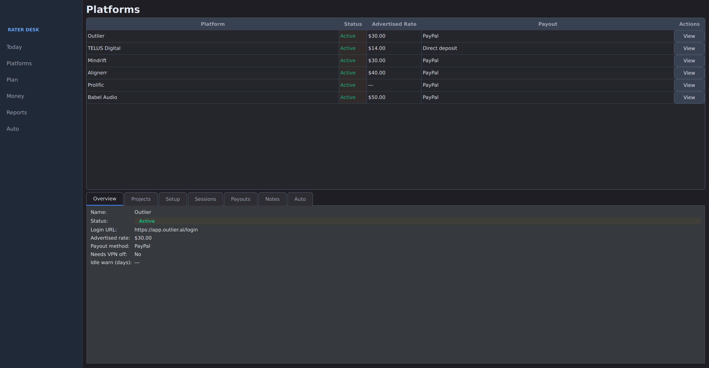
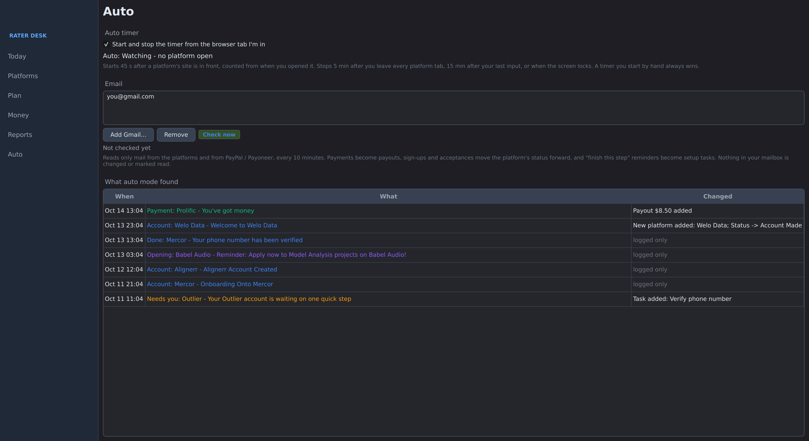

<p align="center">
  
</p>

<h1 align="center">Rater Desk</h1>

<p align="center">
  A desktop app for keeping track of AI rating and training work across different platforms:<br>
  sign-up steps, time worked, payouts, and what each platform actually pays per hour.
</p>

<p align="center">
  <a href="https://github.com/nicholasphillips-systems/rater-desk/actions/workflows/tests.yml"></a>
  <a href="https://github.com/nicholasphillips-systems/rater-desk/releases/latest"></a>
  
  
  <a href="LICENSE"></a>
</p>



## Features

- **Hourly pay:** see what each platform actually paid per hour, next to the rate it advertises.
- **Timer:** start and stop it yourself, or let auto mode do it based on which browser tab you're in.
- **Email:** can read platform and PayPal / Payoneer emails and log payouts and status changes for you.
- **Setup steps:** keep track of where you are in each platform's sign-up.
- **Weekly plan:** plan your work blocks and export them to your calendar (`.ics`).
- **Local:** everything is saved in one file on your computer, with a backup every day.

## Download

**Windows:** download `RaterDesk.exe` from the [latest release](https://github.com/nicholasphillips-systems/rater-desk/releases/latest) and run it. No install or Python needed. Windows will warn you the first time because the file isn't signed: click **More info**, then **Run anyway**.

**Linux:** run it from source (below).

## Screenshots

| Today | Platforms |
|---|---|
|  |  |



<sub>Screenshots use sample data.</sub>

## Run from source

Needs Python 3.10 or newer.

```bash
git clone https://github.com/nicholasphillips-systems/rater-desk.git
cd rater-desk
python3 -m venv ~/.venvs/rater-desk
~/.venvs/rater-desk/bin/pip install -r requirements.txt
./run.sh
```

To add it to your app menu, edit the two paths in `rater-desk.desktop` to point at where you cloned it.

## Auto mode

Turn it on from the **Auto** screen. The timer and the email check work separately, so you can use one without the other.

**Timer**

- Starts once a platform's site has been in front for 45 seconds.
- Stops 5 minutes after you leave all platform tabs, after 15 minutes with no mouse movement, or when you lock the screen.
- Switching to another platform's tab switches the timer over.
- A timer you start yourself always takes priority.
- Sessions under 2 minutes are thrown out.

Works on Windows and KDE Plasma. Other Linux desktops aren't supported yet.

**Email**

Checks Gmail every 10 minutes for mail from the platforms and from PayPal / Payoneer. It only reads, so nothing gets marked as read. You'll need a Gmail [app password](https://myaccount.google.com/apppasswords), which is saved in your system keyring.

| Email | What happens |
|---|---|
| Payment from a platform | Payout added |
| Account created / welcome | Status set to Account Made |
| Accepted / approved | Status set to Active |
| "Verify your phone", "finish your application" | Setup task added |
| "Phone verified" | That task marked done |
| Mail from a platform you don't have yet | Platform added |
| Rejections, project invites, unknown payments | Just logged |

Statuses only move forward, and anything you've marked Blocked, Paused or Dead is left alone. Everything it changes is listed on the Auto screen.

## Good to know

- Your data is saved in `data/rater-desk.sqlite3` (or your user folder on Windows). Set `RATER_DESK_DATA` to use a different folder.
- A backup is made every day in `data/backups/`, and the last 30 are kept.
- Closing the window keeps it running in the system tray. It can also start when you log in.
- If the app closes while a timer is running, it asks what to do with it next time you open it.
- After 90 minutes on one session, it reminds you to take a break.
- New installs start with a list of twelve common platforms.

## Development

### Tests

```bash
~/.venvs/rater-desk/bin/pip install pytest
QT_QPA_PLATFORM=offscreen ~/.venvs/rater-desk/bin/python -m pytest
```

The tests run on Linux and Windows on every push.

### Windows build

From Linux (uses Wine):

```bash
./build-windows.sh        # -> dist/Rater Desk.exe
```

Or on a Windows PC with Python 3.10+, double-click `build-windows.bat`.

### Project layout

<details>
<summary>Files</summary>

```
rater-desk/
├── main.py            # App window, tray, startup
├── paths.py           # Where data is saved on each OS
├── autostart.py       # Start at login
├── schema.sql         # Database tables
├── migrations.py      # Updates older databases
├── store.py           # Database reads and writes
├── starter.py         # Platform list for new installs
├── ics.py             # Calendar export
├── backup.py          # Daily backup
├── catalog.py         # How each platform is recognized (tab titles, email senders)
├── activity.py        # Which window is in front
├── autotimer.py       # Auto timer rules
├── maildetect.py      # What each email means
├── mailwatch.py       # Gmail check
├── run.sh             # Launcher
├── rater-desk.desktop # App menu entry
├── rater-desk.spec    # Windows build recipe
├── build-windows.sh   # Build the .exe from Linux
├── build-windows.bat  # Build the .exe on Windows
├── ui/                # Screens: Today, Platforms, Plan, Money, Reports, Auto
└── tests/
```

</details>

## License

MIT. See [LICENSE](LICENSE).
